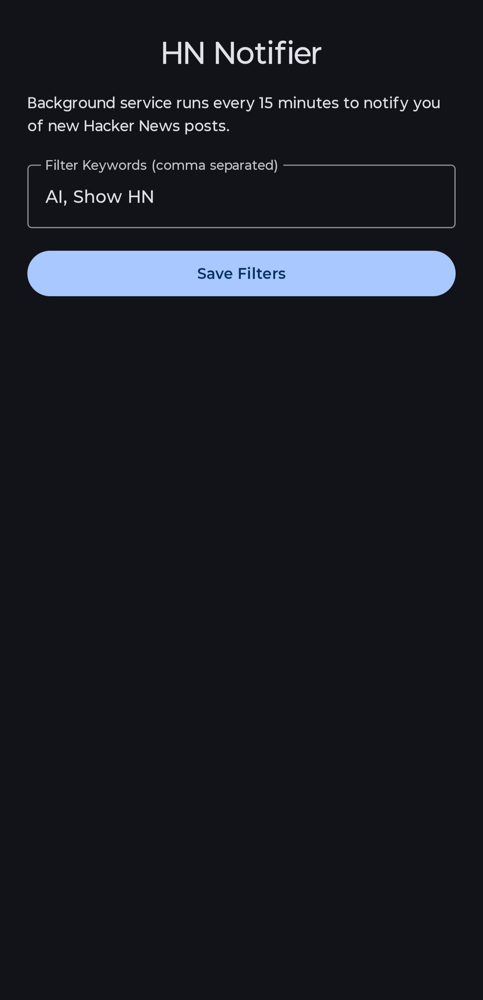

# HN Notifier

> This project is an unofficial, open-source client and is not affiliated with, maintained, authorized, or endorsed by Y Combinator or Hacker News. All content is fetched using the official Hacker News Firebase API.

An android app to display system notifications whenever a new HN post is made. The notifications are filtered according to the filter keywords provided. 

The notifications displayed work as clickable links which redirects to the post.

## How it works

The app makes a call to the official Hacker News API every **30 minutes** to retrieve the latest posts:

```
val prefs = HNPreferences(applicationContext)
val storyJsonText = URL("https://hacker-news.firebaseio.com/v0/item/$storyId.json").readText()
val storyObj = JSONObject(storyJsonText)
val type = storyObj.optString("type", "")
if (type == "story") {
    val title = storyObj.optString("title", "")
    val postUrl = storyObj.optString("url", "").ifEmpty { "https://news.ycombinator.com/item?id=$storyId" }
    if (title.isNotEmpty() && prefs.matchesFilter(title)) {
        showNotification(storyId.toInt(), title, postUrl)
    }
}
```

and filters them with the keywords:

```
fun matchesFilter(title: String): Boolean {
    val currentKeywords = keywords.trim()
    if (currentKeywords.isEmpty()) {
        return true // No filter set, notify for all new stories
    }
    val keywordList = currentKeywords.split(",").map { it.trim().lowercase() }.filter { it.isNotEmpty() }
    if (keywordList.isEmpty()) {
        return true
    }
    val lowerTitle = title.lowercase()
    return keywordList.any { kw -> lowerTitle.contains(kw) }
}
```

## Permissions required

- Network access
- Post Notifications

## UI

A minimal design with short description and filter keywords input box.

<div align="center">
  
</div>

